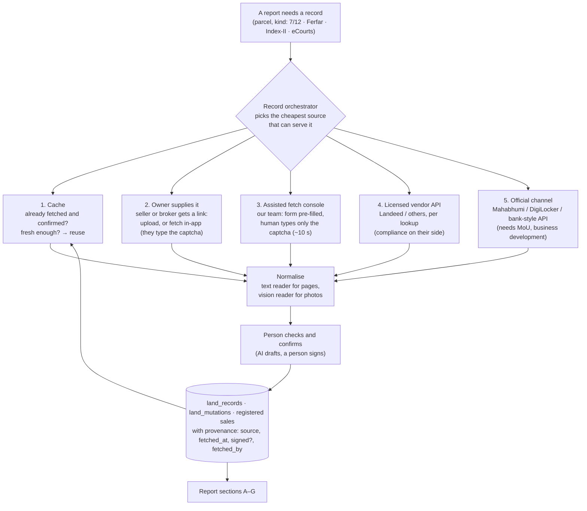

# Getting land records at scale, without solving captchas

Design note, 2026-10-11.

**Problem.** Every Due-Diligence Report needs government land records:
- the 7/12;
- the mutation register (Ferfar);
- Index-II sale records;
- court cases.

Today a person fetches each one by hand from a site with a captcha. That doesn't scale, and
automated captcha-solving is ruled out (owner decision, 2026-10-10).

**The owner's analogy.** Zomato didn't type every customer's address. Each customer entered their
own once; it was saved and reused, and maps filled the gaps.

(Zomato did start by photographing menus by hand. Manual work was the right first step until volume
justified more.)

## The idea in one line

**The people entitled to a land record supply it once.** That means the landowner, the seller's
broker, or the builder's own staff, each for their own parcel. We **store and reuse** every record,
cut the remaining human step to about 10 seconds, and add licensed and official channels as volume
grows.

## Facts this rests on (checked 2026-10-11)

- **Legal standing:** since December 2025, Maharashtra gives digitally downloaded 7/12, 8A and
  mutation records full legal recognition, with no talathi signature needed
  ([Moneylife](https://moneylife.in/article/digital-712-and-mutation-records-get-legal-recognition-in-maharashtra-no-talathi-signature-needed/79064.html),
  [Mondaq](https://webiis10.mondaq.com/india/real-estate/1727362/maharashtras-digital-land-records-reform-and-its-impact-on-land-transactions)).
  A record fetched online is now as good as a paper copy.
- **Costs:**
  - A signed 7/12 costs ₹15 at digitalsatbara.mahabhumi.gov.in (login).
  - Bhulekh's free view has a captcha and says it isn't for legal use.
- **Not found:**
  - no official bulk API for businesses;
  - no confirmation that 7/12s are in DigiLocker;
  - no published Landeed API pricing.

  These are business-development questions.
- **ULPIN** (a 14-digit land parcel ID, part of DILRMP) exists, but there is no national lookup;
  it goes through state portals ([DoLR](https://dolr.gov.in/ulpin/)).

## Who already has, or can get, each record

| Record | Who has it | Who can fetch it |
|---|---|---|
| 7/12, 8A | the seller (needed for any sale) | anyone, via Bhulekh (captcha) or signed for ₹15 (login) |
| Ferfar | the seller, the talathi | anyone, via Mahabhumi (captcha) |
| Title deeds, NA order, tax receipts | **only the seller** | — |
| Index-II (past registrations) | Sub-Registrar | anyone, via IGR e-Search (captcha, paid by year) |
| Court cases | — | anyone, via eCourts (captcha) |

The seller hands these papers over in **every** real deal anyway. The work is collecting them
**before** the deal, digitally and once.

## Design: five sources, cheapest first

### 1. Cache: never fetch the same record twice
- **Store with provenance:** every confirmed record is kept with its source, fetch date, whether
  it's the signed copy, and who fetched it. This exists now: `land_records`, `land_mutations`.
- **Key by land, not report:** records are keyed by **district + taluka + village + survey
  number**. The second builder asking about the same survey number gets it instantly. Today the
  key is the parcel; the next step is the survey number.
- **Freshness:** reuse is fine for screening. Before an advocate signs, re-fetch if older than 30
  days, or if the latest mutation number on the 7/12 has changed. The mutation number is a cheap
  "has anything changed?" signal.
- **Public records only:** these are public records (anyone can fetch them), so sharing the
  cached copy across customers is defensible. Seller-uploaded private papers (deeds, IDs) are
  **not** shared; they belong to that deal (DPDP).

### 2. The owner supplies it (the Zomato move)
**Seller intake link.** The builder or broker sends the seller a WhatsApp link. On a phone
browser page (no app install), the seller:
- types the survey number and village (they know it by heart);
- either opens Bhulekh in the page and types the captcha themselves, the same flow we built, or
  photographs their papers;
- uploads deeds and NA orders, which only they have.

**Why the seller does it:** the council's free **Land Health Report**. They get their own title
gaps before a buyer finds them (`docs/strategy/2026-10-02-level1-marketplace-council.md`). This
also feeds parcels into the marketplace.

**Brokers:** a broker listing a parcel attaches its 7/12 once, and it's reused for every builder
who looks at it.

### 3. Assisted fetch console: our team, 10 seconds a record
This is for when the owner hasn't supplied it.
- **One queue:** a single list of pending lookups across all reports
  (`record_requests`: parcel, kind, status, assigned to, source).
- **The app does everything except the captcha:** it opens the official page in the in-app
  browser and **fills district, taluka, village and survey number by script**. The person's job
  is only to type the captcha and press Submit. The app then takes the page text, as it does now.
- **Capacity:** about 15–30 seconds a record means **one person does roughly 1,000 lookups in a
  day**. Even at 100 reports a day with 10 lookups each, that's one person.

  **At ScridddHub's current stage, captchas are not the bottleneck. Sales are.**
- **The same console covers** Ferfar, IGR e-Search for Index-II (per village and year) and eCourts
  (per owner name). Each gets a small "pre-fill the form" script and a text reader.

### 4. Licensed vendors (when volume or name search needs it)
- **Name search:** vendors such as Landeed sell Index-II search by name (which the official site
  doesn't offer) and documents by API. TEAL sells to banks. Surepass and others resell eCourts.
- **One adapter interface** (`LandRecordSource`), so a vendor is just another source the
  orchestrator can pick. Each lookup's cost is recorded and priced into the report.
- **Before signing,** get written confirmation of how they source the data. If they solve
  captchas, the compliance risk is theirs, but it reflects on us.

### 5. Official channel (the long game)
Ask the Maharashtra revenue department (Mahabhumi / NIC) for institutional API access, as banks
get for loan processing. Also ask:
- whether DigiLocker's Requester API can pull a landowner's 7/12 **with their consent** (the
  cleanest Zomato-style model: owner consents, we pull);
- whether ULPIN lookups can be integrated.

This is business development, possible once there are paying customers to show.

## What changes in the product

| Step | Today | With this design |
|---|---|---|
| A builder orders a report | our team fetches everything | the seller link goes out automatically; the cache answers repeats |
| The seller | not involved | supplies records once, gets a free Land Health Report |
| Our team | full manual fetch | captcha-only, from one queue |
| A repeat survey number | fetched again | instant from the cache |
| Scale beyond one person a day | — | vendor API, then official channel |

## Build order
1. **Pre-fill script for Bhulekh** in the in-app browser, so the human types only the captcha.
   *Small; next.*
2. **Survey-number-keyed cache** with freshness rules (re-fetch before signing if over 30 days
   old, or the mutation number changed).
3. **`record_requests` queue** and an "assisted fetch" screen for the team. Each report's "still
   to collect" items become queue jobs automatically.
4. **Seller intake link** (web page, no install): survey number, in-page Bhulekh, photo upload,
   and a free Land Health Report back.
5. **Same pattern for Ferfar, IGR e-Search and eCourts** (pre-fill script + text reader each).
6. **`LandRecordSource` adapter interface**, and the first vendor once volume justifies paying.
7. **Business development:** Mahabhumi/NIC API, DigiLocker requester, ULPIN.

## What we will not do
- Solve captchas by software or paid solving services (owner decision, 2026-10-10).
- Scrape government sites in bulk, or get around access controls.
- Share a seller's private papers with anyone but that deal's parties.
