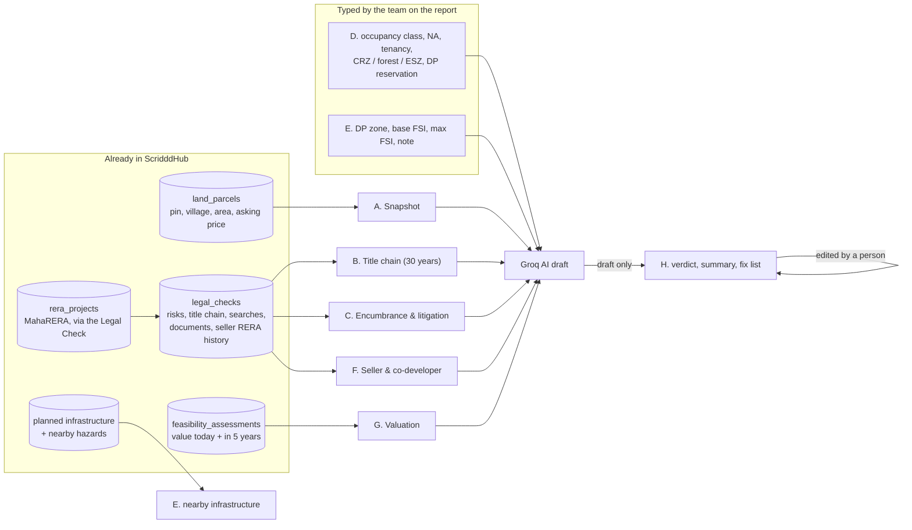
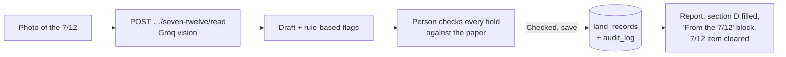
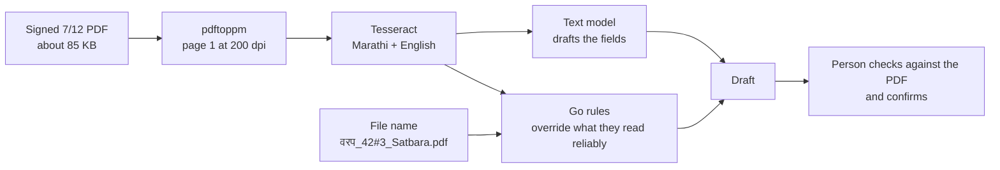
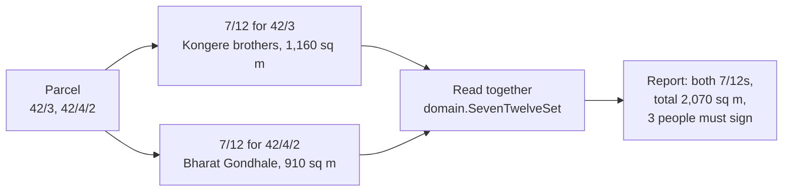
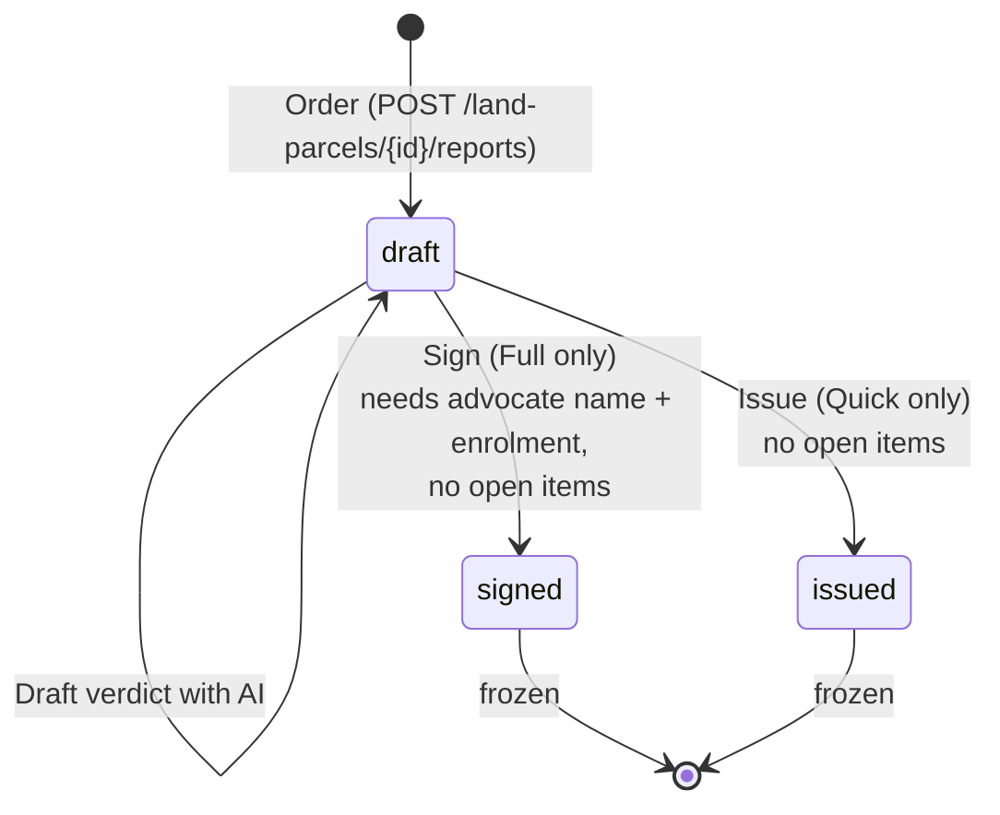
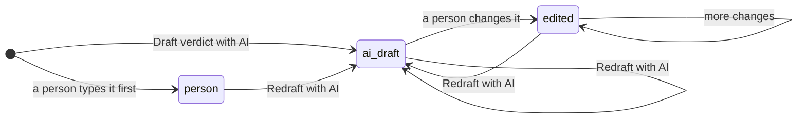
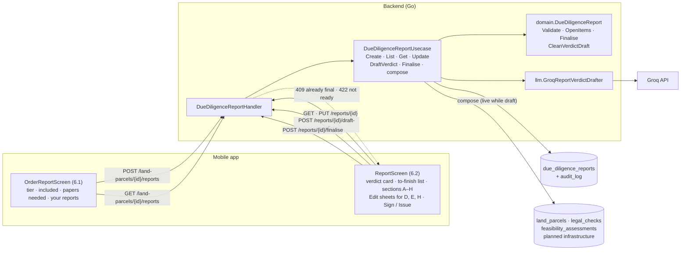
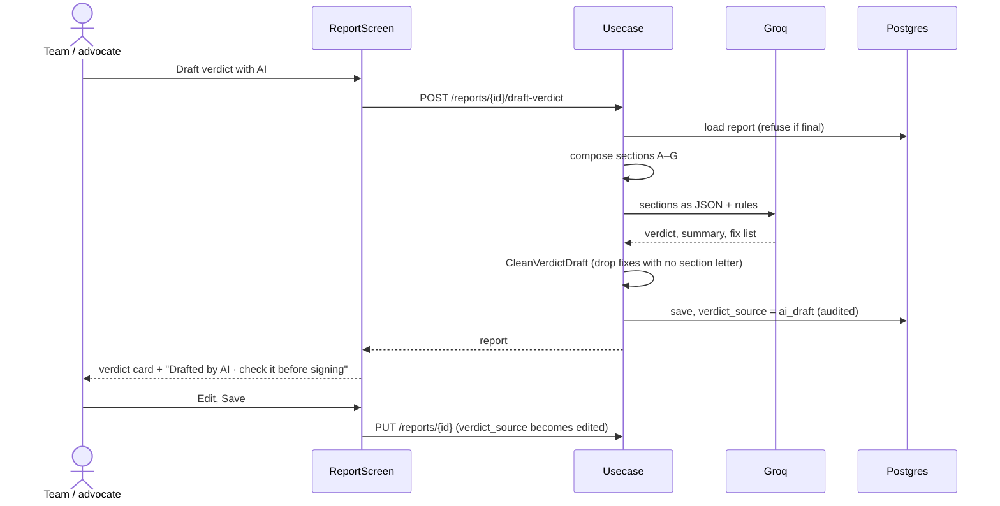
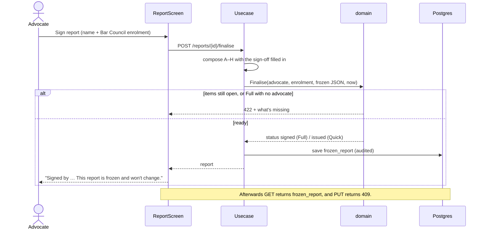

# Parcel Due-Diligence Report (Screens 6.1 and 6.2, Level 1)

Built 2026-10-07. For anyone joining the project, this covers:
- what the report is and who pays for it;
- where each section's data comes from;
- how a report goes from draft to signed;
- the system design behind it.

## In short

**This is the report a builder pays for before buying a parcel.** It brings everything
ScridddHub knows about one parcel into one document:
- title;
- legal searches;
- land status;
- development potential;
- the seller's track record;
- valuation;
- a verdict: **Go**, **Fix first, then buy** or **Don't buy**.

Owner decision (2026-10-07): **the AI drafts, the advocate edits and signs.**

| | Quick Screen | Full Report |
|---|---|---|
| Price (placeholder until confirmed with builders) | ₹7,500 | ₹35,000 |
| For | shortlisting several parcels | the parcel you plan to buy |
| Who finishes it | the team issues it | a partner advocate signs it |
| Must be filled before finishing | verdict, summary, fix list (if Fix first) | the same, plus occupancy class, NA status, DP zone |
| Final status | `issued` | `signed` |
| Scope note says | "A Quick Screen is not a lawyer's opinion" | "The title opinion is the signing advocate's" |

Where to find it in the app:
1. Land Parcels list → the parcel hub → the **Parcel Due-Diligence Report** tile.
2. That opens **Order a Report** (6.1): pick a tier, see what's included and which papers are
   still needed.
3. Order. This opens the **report** itself (6.2).

**Payments aren't connected yet.** Ordering creates a free draft, and the screen says so.

## Why

Builders already pay advocates and consultants for title searches and land checks before buying.
The answers end up spread across PDFs, WhatsApp messages and phone calls.

Most of the inputs are already in ScridddHub:
- the Legal & RERA Check;
- MahaRERA records;
- the valuation;
- planned infrastructure.

The report puts these together in one place. A person (an advocate, for the Full Report) then
stands behind it. This is the screen builders pay for (see
`docs/strategy/2026-10-02-level1-marketplace-council.md`).

## Where each section comes from

| | Section | Source | Filled by |
|---|---|---|---|
| A | Snapshot | the parcel | automatic |
| B | 30-year title chain | Legal & RERA Check, title steps | automatic (typed in the Legal Check) |
| C | Encumbrance & litigation | Legal & RERA Check: 4 risk levels, 3 searches, papers | automatic |
| D | Land status | the report itself | **the team** |
| E | Development potential | the report itself; nearby infrastructure from the infra pipeline | **the team**, plus automatic infra |
| F | Seller & co-developer track record | Legal Check RERA history (from MahaRERA) | automatic |
| G | Valuation, today and in 5 years | Feasibility assessment | automatic |
| H | Verdict and fix list | AI draft from A–G, then a person | **AI drafts, a person edits** |

- **Buildable area** = acres × 43,560 × max FSI, worked out in code.
- **Infrastructure** = up to 6 nearest planned projects, plus nearby hazards (landfills, power
  lines…).
- If an input fails to load, its section shows as empty and the report still opens. The failure
  is logged.

## Added 2026-10-08: so a real parcel's report has no blanks

The owner's aim: a report worth at least ₹5,000 to a builder. A report full of "Not recorded" isn't
worth paying for. Research for these changes:
- `docs/strategy/2026-10-07-due-diligence-report-council.md`: price, data sources, why builders pay.
- UDCPR Table 6-G, read from the sanctioned regulations.
- 7/12 field layout from the 2 Sept 2020 GR.

### 1. Land record details required to order

A report can't be ordered until the parcel has its **survey/gat number, village, taluka and
district**. Every land record lookup (7/12, Ferfar, Index-II) needs all four.
- **App:** a survey number field, plus a village search over all 44,918 Maharashtra villages,
  which fills taluka and district.
- **Backend:** `PUT /land-parcels/{id}/land-record` (migration 047 adds `survey_number`).
  Ordering without them returns 422.

### 2. "Still to collect" instead of blanks

Every gap becomes a line saying what's missing, where it comes from, and who gets it: our team,
the advocate, or the builder (`reportRequirements` in the usecase). Examples:

| Gap | Shown as |
|---|---|
| 7/12 | Our team · digitally signed copy from Mahabhumi (₹15) |
| Court search | Advocate · eCourts and the Bombay High Court case search |
| Tax receipt | You · from the seller |
| Occupancy class | Our team · 7/12, tenure column (भूधारणा पद्धती) |

How the two tiers use the list:
- **Quick Screen:** marks items that only come with the Full Report.
- **Finishing:** a report **can't be issued or signed while any item of its tier is open**
  (422 with the list). So a finished report never has a blank.
- **Verdict:** the AI reads the list and treats each item as open, not as clean.

### 3. FSI band from UDCPR (section E)

The team picks the planning authority and types the access road width. The FSI band is then
looked up in **UDCPR 2020 Table 6-G** (`domain.UDCPRFSIBand`, with tests):
- municipal corporation or "other" (councils, PMRDA/MMRDA areas);
- or a Regional Plan area with no planning authority, where TDR doesn't apply.

| Example | Base | Max | With ancillary (×1.6) |
|---|---|---|---|
| Municipal corporation, 30 m road | 1.10 | 3.00 | 4.80 |
| Council / MMRDA area, 12 m road | 1.10 | 2.00 | 3.20 |
| Any authority, road under 9 m | 1.10 | 1.10 | 1.76 |

- Buildable area = acres × 43,560 × max FSI, labelled "before road and amenity deductions".
- **Mumbai (DCPR 2034) and CIDCO/NAINA** aren't covered by UDCPR. They return a note, not a guess.
- The figure is always labelled a band that "the architect confirms". An architect's figure,
  when entered, replaces it.
- **Not checked yet:** UDCPR amendments after Jan 2023.

### 4. Reading the 7/12 (AI drafts, a person confirms)

Flow: photo → `POST /land-parcels/{id}/seven-twelve/read` (the body is the image) → a draft →
the person checks every field against the paper → `PUT /land-parcels/{id}/seven-twelve`
(migration 049, `land_records`, audited).

- **Model:** Groq `qwen/qwen3.8-27b`, the only vision model on our Groq key. It's in Preview, so
  it can be withdrawn. Fallbacks the research found: Gemini Flash-Lite, or Sarvam Vision for
  handwritten Ferfar.
- **What's extracted:** holders with mutation numbers, former holders, tenure class, area
  (hectare.are, parsed in Go by `domain.ParseHectareAre`, never by the model), tenants, other
  rights, pending mutations, last mutation, NA note, digital signature.
- **Warning flags come from rules, not the AI** (`SevenTwelve.Flags`):
  - Class II or government lease;
  - a tenant;
  - a bank charge (बोजा), acquisition or transfer restriction;
  - a pending mutation;
  - not digitally signed;
  - several current holders;
  - 7/12 area more than 5% off the parcel's entered area;
  - in the report, the 7/12's survey number differs from the one given at order
    (`domain.SameSurveyNumber` treats "45/2A" and "45/2/अ" as the same).
- **In the report:** a confirmed 7/12 fills section D (class, NA, tenancy/other rights) wherever
  the team hasn't typed something, and adds a "From the 7/12" block (holders, area, flags).
- **Tested only on a made-up sample** (a page labelled SAMPLE, kept in the scratchpad, never the
  repo). It read the current holders, survey number, class, area and bank charge correctly. It
  **got wrong** the village spelling (ल for ळ), the struck-through former holder's name, and that
  holder's mutation number (056 for 856).
  - That's why a person must confirm every field.
  - **Accuracy on real 7/12s is unknown** until we test on real ones.

## Added 2026-10-10

### 5. PDF of the report
`GET /reports/{id}/pdf` (or `?format=html` to preview) renders an A4 document:
- verdict first;
- a DRAFT watermark and the "still to collect" table on drafts;
- every section with its source;
- the scope note and the advocate's sign-off.

It uses headless Chrome (`internal/reportpdf`) because Chrome shapes Marathi text correctly; the
pure-Go PDF libraries don't.
- **On a Linux server:** install Chromium and Noto Sans Devanagari, or set `CHROME_PATH`.
- **In the app:** "Download PDF" opens it in the phone's browser, which can save and share it.

### 6. Eco-sensitive zone check (D)
Notifications and their village lists are typed from the gazette into `esz_villages` (migration
050).
- **Loaded so far:** Matheran ESZ, S.O. 133(E), 4 Feb 2003, 89 villages.
- **Matching is by district + taluka + village** (`domain.CheckESZ`):
  - The list has "Dhamani" in Panvel, but Dhamni in Karjat is a different village, so matching by
    name alone would wrongly flag it.
  - Common spelling differences fold together (w/v, Tarf/T.).
  - Ulhasnagar tehsil of 2003 is treated as today's Ambernath.
  - A near spelling is flagged for a person to confirm.
- **The report names which notifications were checked.** It never says "outside all ESZs".
- **Still to load:** SGNP (S.O. 3645(E), 2016), Tungareshwar, Thane Creek, Karnala, Bhimashankar
  (draft), Western Ghats ESA (7th draft).

### 7. Registered sales typed from Index-II (G)
`POST /registered-transactions` records one sale (the app's "Registered sales" screen).
- **Reviewer:** the person entering it. A non-comparable sale needs a reason.
- **Evidence:** the raw entry is archived as the sale's evidence record.
- **Matching:** a pinned parcel now also sees **same-village** sales that have no coordinates.
  Index-II gives village and survey number, not a map pin.
- **Valuation:** with 3 or more comparable sales it has real evidence and judges the asking price.

### 8. Mutation register (Ferfar) reader, the title chain (B)
Same pattern as the 7/12: photos → draft → a person checks every entry → saved (migration 051,
`land_mutations`). Pages are added one at a time into one draft.

**The entry type is decided by rules** from the words written in the entry
(`domain.ClassifyMutationText`: खरेदी, वारस, बक्षीस, वाटप, बोजा, बोजा कमी…). The AI's own guess
isn't used.
- **Why:** on a SAMPLE page the AI called a sale (खरेदी) a "charge released" and a gift a
  "partition". The first would have hidden an unpaid bank loan.
- **After the fix:** all four sample entries were typed correctly; one name was still misspelled.

**Flags (rules):**
- years covered against the 30 a title search needs;
- a bank charge with no later release;
- pending or rejected entries;
- inheritance (check all heirs);
- court orders and acquisition;
- a seller who never received the land in an earlier entry.

**In the report:** confirmed entries become section B, clear the Ferfar item, and add "older
records to complete 30 years" when the register is shorter.

**Accuracy on real registers is untested**, and handwritten older entries will be harder.

### 9. Getting the 7/12 from Bhulekh inside the app (a person types the captcha)
On the 7/12 screen, **"Open Bhulekh (you type the captcha)"** opens bhulekh.mahabhumi.gov.in in
an in-app browser, with the parcel's survey number and village shown as a hint.
1. The person picks district, taluka and village, enters the survey number, and **types the
   captcha themselves**.
2. When the 7/12 shows, they tap **"Use this 7/12"**.
3. The app takes the page's visible text (`document.body.innerText`) and sends it to
   `POST /land-parcels/{id}/seven-twelve/read-text`.
4. A text model (gpt-oss-120b) fills the same draft, which is checked and confirmed as before.

**Rules:**
- **No captcha automation:** the owner decided against solving services (2026-10-10). The app
  never fills in or submits the captcha.
- Only pages from `mahabhumi.gov.in` are accepted.
- A page that doesn't show a 7/12 yet is refused before any AI call (`ErrNotSevenTwelvePage`).
- **Never treated as the signed copy:** Bhulekh says its pages aren't for legal use, so
  `digitally_signed` is forced to false and the note records the source. The report's flag still
  asks for the ₹15 signed copy.
- **If Bhulekh shows the 7/12 as an image** rather than text, the app says so: take a phone
  screenshot and use "Choose from gallery" (the photo reader).

**Tested 2026-10-11 on Nilaje 1/1/अ:** Bhulekh now shows the 7/12 as a JPEG (no text), under
"VIEW ONLY" watermarks. Neither the vision model nor Tesseract read the holders' names right
reliably from it. The free view is good for a person to look at, not for the app to read.

## Added 2026-10-14

### 10. The signed 7/12 PDF from Digital Satbara
The copy lawyers and banks use. A person buys it on **digitalsatbara.mahabhumi.gov.in** (OTP
login, wallet top-up through SBI ePay, **₹15 per 7/12**, choose **अंकित सातबारा**) and uploads it on
the 7/12 screen with **"Upload signed 7/12 PDF (Digital Satbara)"**. It goes to
`POST /land-parcels/{id}/seven-twelve/read-pdf?filename=…`.

**Why it's read this way:**
- The PDF's own text layer is in a legacy (non-Unicode) Marathi font: copying it out gives
  gibberish. The printed page is clean, so it's rendered and read with Tesseract, run locally.
- **200 dpi** is deliberate. At 150, 250 and 300 dpi Tesseract misread the survey number, digits
  or a surname on the test page; at 200 it read them exactly.
- No black-and-white clean-up: it helps on Bhulekh's watermarked JPEG but breaks the thin strokes
  of Marathi letters on this clean print.

**Read by rules, not the AI** (`domain/seven_twelve_signed.go`). The AI drafts the rest; these
override it because the AI was seen getting them wrong:

| Field | Rule |
|---|---|
| Survey number | From the file name Digital Satbara gives the download (`<village>_<survey, # for />_Satbara.pdf`) |
| Area unit | आर.चौ.मी → `are`; हे.आर.चौ.मी → `hectare`. **NA land uses आर.चौ.मी**: "11.60.00" is 1,160 sq m, not 11 ha |
| Total area | The holders' common-area line ("सामाईक क्षेत्र ११.६०.००"), else the column totals. The AI took the assessment (३७६.००) instead |
| Tenure | "भोगवटादार वर्ग-१/२". Tesseract reads १ as 9 |
| NA | "अकृषिक वापर" or "बिन शेती" on the page |
| Other rights | The NA order (recorded as a permission, not a concern) and "तुकडा (…)". The AI listed them differently each run |
| Tenant | Cleared if it's a holder's name. OCR runs a name into the "कुळाचे नाव" heading |
| Signed | The 16-digit verification number and signing date from the footer |

**Tested on Varap 42/3, Kalyan (signed 20/06/2022, bought 2026-10-14), three runs, all identical:**
survey 42/3, वरप, Class 1, 11.60.00 are (1,160 sq m), NA, holders कमलाकर परशराम कोंगरे and दिलीप
परशराम कोंगरे (mutation १०९०), no pending mutations, last mutation १०९० on १९/०७/२०२१, the NA order
SR-10/2019, verification no. 2112100001134296. **Missed:** the "तुकडा (९९)" entry wasn't readable
at 200 dpi; the person adds it when checking.

**Needs on the server:** Tesseract with `mar.traineddata` (tessdata_best) and poppler's
`pdftoppm`. Paths: `TESSERACT_BIN`, `TESSDATA_DIR`, `PDFTOPPM_BIN`. If either is missing the server
logs it and the endpoint returns 503.

**Second test, Varap 42/4/2** (one holder, so no common-area line): first read took the khata
number (१२९) for the area because OCR printed "बिन होती" for बिन शेती. Fixed in the rules; both
pages now read correctly.

### 11. Land on several survey numbers: one 7/12 each
Builder land usually spans several survey numbers (Varap: 42/3 and 42/4/2), and each has its own
7/12 with its own holders. The parcel's survey number field takes them comma-separated
("42/3, 42/4/2"), and **a 7/12 is saved per survey number** (migration 053: `land_records` is
unique on parcel + `survey_key`). Saving a 7/12 for the same survey number again replaces it;
"Remove this 7/12" deletes one (`DELETE /land-parcels/{id}/seven-twelve?survey=`).

**Read across the set, by rules** (`domain/seven_twelve_set.go`):
- **A survey number with no 7/12 yet** is a high flag and a "still to collect" line of its own.
- **Everyone who must sign**, across all pieces, with the piece each holds.
- **Total area** against the parcel's, only once every piece is in (one piece's area isn't the
  parcel's).
- **A 7/12 for a survey number not on the parcel** is a high flag (wrong land).
- **Class and NA** fill section D only when every piece is in and they agree. Any Class II piece
  makes the parcel Class II.
- The AI verdict now sees every 7/12 (holders, class, area, rights, warnings). Before this it saw
  none of them.

Reports frozen before 2026-10-15 kept their single 7/12; it's read into the list when opened.

**Tested 2026-10-15** on a throwaway parcel with the two real Varap PDFs: both saved side by side,
2,070 sq m, three holders; removing 42/4/2 brought back "No 7/12 yet for 42/4/2"; the report
filled Class I and NA granted once both were in; the PDF showed both sections and the summary.

## Life of a report

**Who wrote the verdict** is stored as `verdict_source`:

The app shows **"Drafted by AI · check it before signing"** only while the source is `ai_draft`.
The model name is kept in `verdict_model` for the record. It's never shown in the app.

## System design

### Drafting the verdict with AI

### Signing and freezing

## Rules
- **The AI only drafts.** It never signs, issues or changes D or E. The prompt
  (`llm/groq_report_verdict.go`) says:
  - never invent facts, cases, documents or names;
  - treat anything unknown or not checked as something to fix, not as clean;
  - quote abbreviations as written ("CC pending"). Don't expand them, since many have more
    than one meaning;
  - start every fix item with its section letter (`B: record the 2009 heirship mutation…`);
  - never say "clean title" or "verified".
- **Fix items must cite a section.** `domain.CleanVerdictDraft` keeps only items starting
  `A:` to `G:`.
- **Open items block finishing** (`domain.DueDiligenceReport.OpenItems`). The app shows them as
  "To finish: …", and the backend returns 422.
  - Both tiers need a verdict, a summary, and a fix list if the verdict is Fix first.
  - A Full Report also needs occupancy class, NA status and DP zone.
- **A Full Report can't be signed without an advocate:** name and Bar Council enrolment number.
- **Finishing freezes the report.** The composed sections are stored in `frozen_report`.
  - Later changes to the parcel, Legal Check or valuation don't change a signed report.
  - Edits return 409.
- **No "verified" badge anywhere.** The scope note gives the date, says government land records
  are presumptive (not a guarantee of title), and says whose opinion it is.
- **Every create and edit is audited** (ADR-0002).

## Storage

Table `due_diligence_reports` (migration `000046`). A parcel can have many reports.

| Group | Columns |
|---|---|
| Identity | `id`, `land_parcel_id`, `tier` (`quick` / `full`), `status` (`draft` / `signed` / `issued`) |
| D. Land status | `occupancy_class`, `na_status`, `tenancy_remarks`, `crz_forest_esz`, `dp_zone`, `dp_reservation` |
| E. Development | `base_fsi`, `max_fsi`, `development_note` |
| H. Verdict | `verdict` (`go` / `fix_first` / `no_go`), `verdict_summary`, `fix_list` (JSONB), `verdict_source`, `verdict_model` |
| Sign-off | `advocate_name`, `advocate_enrolment`, `finalised_at`, `frozen_report` (JSONB) |

Sections A, B, C, F and G aren't stored on the report. They're read live from their sources
until the report is finalised, then kept in `frozen_report`.

## API
| Method | Path | What it does | Errors |
|---|---|---|---|
| POST | `/land-parcels/{parcelID}/reports` | create a draft (`tier`: `quick` / `full`) | 400 bad tier, 404 parcel |
| GET | `/land-parcels/{parcelID}/reports` | list the parcel's reports | |
| GET | `/reports/{reportID}` | report + sections (frozen once final) | 404 |
| PUT | `/reports/{reportID}` | save D, E and H | 400 invalid, 409 final |
| POST | `/reports/{reportID}/draft-verdict` | AI draft of verdict, summary and fix list | 409 final |
| POST | `/reports/{reportID}/finalise` | sign (Full, with advocate) or issue (Quick) | 409 final, 422 not ready |

Schemas live in `backend/api/openapi.yaml`:
- `ReportSummary`, `ReportDetail`, `ReportEdits`;
- `ReportSections`, `ReportRisk`, `ReportInfra`.

The app's types are generated from that file (`npm run generate` in `packages/api-client`).

## Where the code is

| Part | File |
|---|---|
| Screens | `mobile-app/src/screens/OrderReportScreen.tsx`, `ReportScreen.tsx` |
| Hub tile and routes | `mobile-app/src/screens/ParcelHubScreen.tsx`, `mobile-app/App.tsx` (`orderReport`, `report`) |
| Rules | `backend/internal/domain/due_diligence_report.go` (+ tests) |
| Building the sections, draft, finalise | `backend/internal/usecase/due_diligence_report.go` |
| AI draft | `backend/internal/llm/groq_report_verdict.go` |
| Endpoints | `backend/internal/handler/due_diligence_report.go`, routes in `cmd/server/main.go` |
| Storage | `backend/migrations/000046_due_diligence_reports.*`, `repository/postgres/due_diligence_report.go` |

## How it was tested (2026-10-07, Test plot Nilaje)
- **Full Report:**
  - The AI drafted Fix first, with section-cited fixes.
  - Signing with no advocate returned 422.
  - Signed by "Test Advocate (sample)", MAH/0000/2020.
  - An edit after signing returned 409, and the frozen copy shows in the app.
- **Quick Screen, all in the app:**
  - order → Draft verdict with AI → Edit and Save (the AI label goes away) → Issue;
  - the report shows "Issued … without a lawyer", frozen.
- **Found and fixed:**
  - The AI turned "CC pending" into "regulatory clearance". In Maharashtra, CC usually means
    Commencement Certificate or Completion Certificate. The prompt now keeps abbreviations as
    written.

## Not done yet
- **Payments.** Ordering is free for now.
- **Real advocate signing.** Today the advocate signs by typing their name inside our app.
  There's no digital signature or advocate login. Before charging builders, decide between a
  digital signature certificate (DSC) and uploading a signed PDF.
- **PDF export / share link (6.5)** isn't built.
- **B stays empty until the ownership chain from the 7/12 is built**
  (`tasks-todo/ownership-chain-from-7-12.md`).
- **D and E are typed by hand.** DP zone and FSI could later come from DP maps.
- **Sample data:** the test reports on "Test plot Nilaje" are signed by "Test Advocate (sample)",
  MAH/0000/2020. Remove them with the test parcels.
