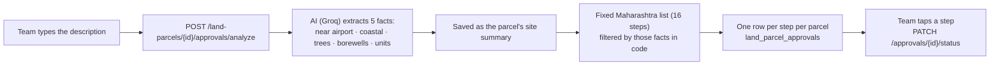

# Government Approvals (Screen 7, Level 1)

Rebuilt 2026-10-03. This explains what the screen does, how it works, and what has not been
verified yet.

## In short

**After the land is bought, the team tracks every government approval the project needs, in the
order Maharashtra requires them.** The team describes the project in plain words. The AI picks
out the facts that decide which approvals apply, and the team then marks each step's status as
departments respond.

Opened from **"Deal Closed — Start Approvals"** on the Legal & RERA Check (Screen 6).

## What the screen shows

| Part | What it does |
|---|---|
| Tell us about your project | A description box, pre-filled from the parcel on first visit ("3.5 acre residential plot in Nilaje.") |
| Work out approvals / Re-analyze | Sends the description to the AI and builds the approval list |
| "AI understood this" chips | What the AI read: inland or coastal, trees, borewells, near an airport, number of units |
| Progress | "3 of 13 approved", a bar, and how many steps were filtered out |
| Required sequence | All steps in order, each with a status pill. Conditional steps say why they're in or out ("Not needed: site is not near an airport · not right?") |
| Tap a step | Set its status: Not started, Submitted, Approved, Not yet due, or Not needed. Submitted records today's date and shows a day counter ("Submitted · 18d") |

## How it works

Nothing runs in the background. One tap does this:

- **The AI only reads the description.** It decides nothing about law. The rules ("Airport
  clearance only if near an airport") are fixed in code (`domain.ApprovalPlaybookEntry.Applies`).
- **Re-analyze is safe.** A step that is already Submitted or Approved is never reset. Only
  whether a step applies is updated.
- **Overrides:** setting a step to "Not needed" or back to "Not started" by hand sticks until a
  later Re-analyze changes whether it applies.
- **Every change is audited** (ADR-0002).

## The 16 steps and when they apply

Always: Land Use / Zoning, Environmental NOC, Layout / Plan Sanction, Commencement Certificate,
BOCW Registration, RERA Registration, Fire NOC, Water, Electricity, Sewage, Completion
Certificate, Occupancy Certificate.

Only when the description says so: Airport Authority (near an airport), CRZ (coastal), Tree
Felling NOC (significant trees), Groundwater NOC (borewells).

## Not verified yet (important)

**The 16-step list is prototype content.** It was copied from the wireframe's Screen 7 mockup
(migration `000007_create_approval_playbooks`, whose header says so). It has **not** been checked
against official Maharashtra rules, UDCPR, or a municipal corporation's actual process. Before a
real builder relies on it:
- an architect or liaison consultant must review the steps, the order and the conditions;
- thresholds that decide applicability need adding (e.g. the environmental clearance depends on
  built-up area, not just "any project");
- each step should cite its official source, like the planned-infrastructure facts do.

## API
- `POST /land-parcels/{parcelID}/approvals/analyze` with `{free_text}` builds or updates the list.
- `GET /land-parcels/{parcelID}/approvals` returns the list.
- `GET /land-parcels/{parcelID}/site-summary` returns the description and the extracted facts.
- `PATCH /approvals/{approvalID}/status` with `{status, submitted_at}` sets one step's status.

## Where the code is

| Part | File |
|---|---|
| Screen | `mobile-app/src/screens/GovernmentApprovalsScreen.tsx` |
| Applicability rules | `backend/internal/domain/government_approval.go` |
| Analyze and reconcile | `backend/internal/usecase/government_approval.go` |
| AI extraction | `backend/internal/llm/groq_extractor.go` |
| Endpoints | `backend/internal/handler/government_approval.go` |
| The 16 steps | `backend/migrations/000007_create_approval_playbooks.up.sql` |
