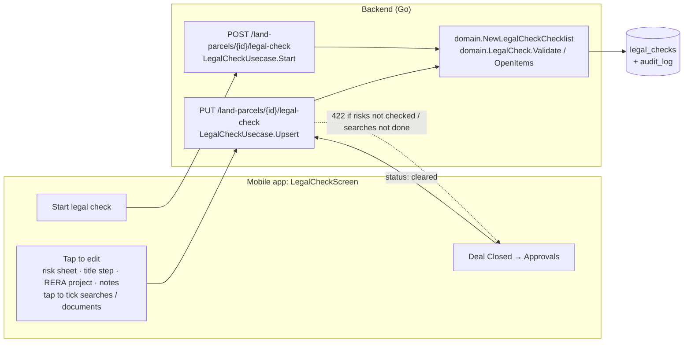

# Legal & RERA Check (Screen 6, Level 1)

Built 2026-10-01. For anyone joining the project: what this screen answers, how it works for any
parcel, and the system design behind it.

## In short

**Before a parcel is bought, the team checks that the title is clean and the seller is reliable,
then signs it off item by item.** Any parcel can start a check. Every item starts open, the team
fills it in, and "Deal Closed" unlocks only when nothing that matters is left unchecked.

| Section | What the team records |
|---|---|
| Risk Breakdown | Ownership, Litigation, Encumbrance, Regulatory: each Not checked / Low / Medium / High, with a short note ("CC pending") |
| Ownership Chain | Each transfer from the earliest record to the current owner; the last step marks "traced back N years, uncontested" |
| Encumbrance & Litigation Search | Three public-record searches, ticked when done, plus a line on what they found |
| Seller / Co-developer RERA History | The seller's past MahaRERA projects, registration numbers and how they were delivered, plus a summary |
| Documents | 7/12 Extract, Mutation entries (Ferfar), Title Deed, Encumbrance Certificate, Tax Clearance Receipt (more can be added) |
| JDA note | Reminder of the extra checks when the deal is a Joint Development Agreement |

## Why

Title problems are the most common way a land deal goes wrong in Maharashtra: a missing link in
the chain, an undisclosed mortgage, a pending suit, an acquisition notice. The screen and its
storage already existed, but nothing created a check, so every new parcel said "No legal check
recorded".

## Rules
- **People judge, not the AI.** Legal risk can't be estimated from a location; it comes from
  documents and searches. Nothing on this screen is generated. (AI drafting from uploaded
  documents is possible later, as drafts a person signs off.)
- **Honest starting state:** every risk starts **Not checked**, not "Low".
- **What blocks "Deal Closed":** any risk still Not checked, or any search not done
  (`domain.LegalCheck.OpenItems`). The backend refuses to clear with HTTP 422 and lists what's
  open; the app shows the same list under the button.
- **Pending documents don't block** (the design clears with a tax receipt still pending).
  A High risk doesn't block either: a person may knowingly accept it.
- **Starting twice never resets** a check in progress.
- **Every change is audited** (ADR-0002): each save writes an `audit_log` row with before/after.

## System design

**Flow:**
1. A parcel with no check shows "Start legal check". `POST` creates the standard checklist,
   or returns the existing one.
2. Each edit sends the whole check with `PUT`. The screen updates at once and rolls back if the
   save fails.
3. "Deal Closed" sends `status: cleared`. The domain rejects it while anything is open;
   otherwise it saves and the app moves to Government Approvals (Screen 7).

## Storage

Table `legal_checks` (migration 006), one row per parcel. Risks are text columns with a note
each; the chain, searches, RERA history and documents are JSONB arrays saved with the check.
Migration `000042_legal_check_not_checked` adds `not_checked` to the four risk columns.

## API
- `POST /land-parcels/{parcelID}/legal-check` starts (or returns) the check.
- `PUT /land-parcels/{parcelID}/legal-check` saves it; 422 when cleared too early.
- `GET /land-parcels/{parcelID}/legal-check` reads it; 404 if never started.

## Where the code is

| Part | File |
|---|---|
| Checklist, levels, clearing rule | `backend/internal/domain/legal_check.go` (+ tests) |
| Start / save | `backend/internal/usecase/legal_check.go` |
| Endpoints | `backend/internal/handler/legal_check.go`, routes in `cmd/server/main.go` |
| Storage | `backend/migrations/000006_*`, `000042_*`, `repository/postgres/legal_check.go` |
| Screen | `mobile-app/src/screens/LegalCheckScreen.tsx` |

## Seller RERA history from MahaRERA (automatic)

"Find seller on MahaRERA" fills the RERA section from public records instead of typing:
type the developer's name, pick the match, preview their projects, tap "Add N projects".

| What | Source (public, no captcha) | Collected into |
|---|---|---|
| Registered projects: MahaRERA number, name, promoter, location, pincode, district, last modified, extension certificate yes/no | MahaRERA project search, `www.maharera.maharashtra.gov.in/projects-search-result` (49,681 projects, 10 per page) | `rera_projects` |
| Complaints per promoter | MahaRERA "Promoter Wise Complaint List", `/promoter-complaint-report` (5,415 promoters) | `rera_promoter_complaints` |

- **Collector:** `go run ./cmd/rera_import -pincodes ../services/legalcheck/maharashtra_pincodes.txt`
  (statewide, recommended), `-complaints` (complaint list), `-district 517` (Thane). One page
  every 4 s. Re-run monthly; rows update in place.
  - **Why pincode by pincode:** MahaRERA's site stops returning rows on very deep pages. Thane
    pages ~650+ of 697 came back empty, so a whole-state run (4,969 pages) can't reach everything.
    Pincode searches stay a few pages deep.
  - **Flaky pages, two kinds:** a total with no rows, and "Unable to find records" for a pincode
    that does have projects. The second fooled the first statewide run (2026-10-02): it got
    14,544 of 49,681 projects, and Wakad (411057) had 3 of 646. Now an empty page after page 1
    is always retried, and an "empty" page 1 is retried twice before it's believed. A pincode
    whose stored count already matches MahaRERA's total is skipped after page 1, so re-runs only
    fill gaps.
  - **Pincode list:** `maharashtra_pincodes.txt`, 1,583 pincodes from
    [GeoNames](https://download.geonames.org/export/zip/) (CC BY 4.0), plus pincodes already
    seen in collected projects. Failed pincodes go to `<file>.failed` for a rerun.
  - Statewide is marked complete only when collected projects reach 99% of the total MahaRERA
    reports (49,681 on 2026-10-01).
- **No claim before the data is complete** (`rera_collection_runs`, migration 044):
  - A complaint count appears only after a full complaint-list run. Before that, "0" might
    just mean "not collected yet".
  - Until a full statewide project run finishes, the screen says "N projects found", not
    "N registered projects".
  - A run is marked complete when it covered every page. If pages were skipped, refetch them
    with `-pages … -finishes complaints|projects_state`.
- **Matching:** promoter names are normalized ("M/s. X Pvt. Ltd." = "X PRIVATE LIMITED")
  in `domain.NormalizePromoterName`; search also finds near-spellings (trigram).
- **What each added project says:** "time extension granted" when MahaRERA lists an
  extension certificate, otherwise "no extension on record". The summary line gives the
  number of projects, how many had an extension, and complaints on record, with the date.
- **Honest limit:** MahaRERA's public list doesn't say "delivered on time" or "4 months
  late". An extension is the only delay signal it gives. The project details page is on the
  newer maharerait portal, behind a captcha, so it isn't used.
- **Not used on purpose:** the maharerait portal's search, which has a captcha. Its API is
  not called directly, because that would skip the captcha.
- **Endpoints:** `GET /rera/promoters?q=` (name search, 3+ characters) and
  `GET /rera/promoters/history?name=` (projects + complaints).
- **Code:** `internal/rera/` (client + parser, tested on saved real pages),
  `repository/postgres/rera.go`, `handler/rera.go`, `cmd/rera_import`, migration 043.

## Known limits
- **Ownership chain is still typed by hand.** It comes from the 7/12 extract and mutation
  entries (Ferfar). Bhulekh has a captcha on every lookup and digital 7/12 needs a login, so
  it can't be fetched. Planned: upload the 7/12 + Ferfar the seller provides, the AI drafts the
  chain (allotment, sale, inheritance, gift, partition, bank charge, court order…) and the team
  confirms. Waiting on one real 7/12 to build against (`tasks-todo/ownership-chain-from-7-12.md`).
- **Court cases (eCourts) are not searched automatically** yet; the litigation search is ticked
  by hand.
- **No document upload yet.** Ticking a document records that it was received, not the file.
- **One reviewer, no sign-off name.** The audit log records who saved each change, but the
  screen doesn't show "cleared by" yet.
