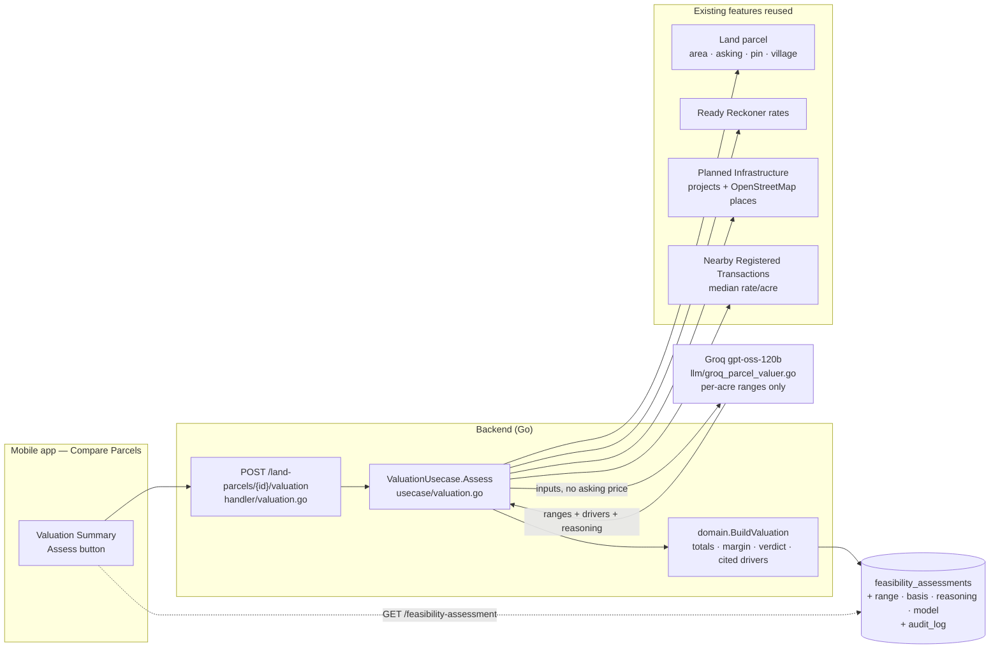

# Valuation Summary (Compare Parcels)

Built 2026-10-01. For anyone joining the project: what this section answers, how it works for
any parcel, and the system design behind it.

## In short

**For any parcel, show what it's worth today, what it may be worth in 5 years, and how that
compares with the asking price.** Every number says what it's based on, and it works for a
parcel we've never seen, not just the ones we prepared.

On the Compare screen, each parcel has:

| Row | What it shows |
|---|---|
| Asking price | From the parcel ("I have a price"), or "No price yet" |
| Value today | A range (for example ₹7.0–10.5 Cr) with the likely value under it |
| vs. asking | Likely value minus asking price, in ₹ lakh |
| Value in (this year + 5) | A range, with the named projects driving any growth |
| Based on | Pinned or typed location · government rate or not · nearby sales or not · planned projects · nearby places |
| Assess / Re-assess | Runs the valuation now (one AI call) |

The summary strip under the table shows the verdict ("Asking price below / near / above
estimated value") and the estimated margin. The Compare screen's top card already picks the
parcel with the highest margin.

## Why

A buyer comparing parcels needs one question answered: **is this price worth it, now and later?**
The inputs already existed in separate places (the Ready Reckoner rate, the AI estimate on the Add
Parcel form, nearby infrastructure, nearby sales), but nothing combined them. The assessment
record behind this section was storage only: nothing wrote it, so every parcel said "Not
assessed". Estimate Value on the Add Parcel form calculated a value and then threw it away.

## How it works for any parcel

Assess uses only what can be known about any saved parcel, and skips what isn't available:

| Input | Source | When available |
|---|---|---|
| Area | The parcel | Required. Without it Assess replies "add the parcel's area" (HTTP 422) |
| Ready Reckoner rate (government floor) | `ready_reckoner_rates`, for the village picked from the dropdown | When a village with a seeded rate was picked |
| Nearby planned projects and existing places | Planned Infrastructure, from the pin or the typed location | Always tried; pinned parcels are measured precisely |
| Nearby registered sales (median rate per acre) | Nearby Registered Transactions | Used automatically once sales data is loaded |
| Asking price | The parcel | Recorded and compared, **but never sent to the AI** |

## Rules
- **The AI proposes per-acre ranges only:** low, likely and high, today and in 5 years.
  Everything else is computed in code (`domain.BuildValuation`):
  - **totals** (rate × area);
  - **the margin:** (likely − asking) ÷ asking;
  - **the verdict:** within ±10% counts as "near".
- **The asking price is withheld from the AI,** because it would anchor the estimate to the
  seller's number and defeat the comparison.
- **No verdict without market evidence** (added 2026-10-08). Evidence means registered sales
  nearby or a government ready-reckoner rate. With neither, the range is only the model's
  general knowledge.
  - **What happened:** on the first real parcel (Dhamni, Karjat) it said ₹8 lakh/acre, where
    2026 registered deals nearby were ₹33–50 lakh/acre.
  - **The rule now:** the verdict becomes "Not enough market evidence to judge the asking price"
    (`domain.VerdictNoMarketEvidence`) with no margin.
  - **The app** shows no value on the hub, the Compare screen, Feasibility or the report. The
    report asks for Index-II sale prices and the ready-reckoner rate instead.
- **No invented projects:** a growth driver is kept only if it names a project the AI was given.
- **Recorded, not black-box (ADR-0005):** every assessment stores its basis (inputs, model,
  date). A re-assess replaces it; the audit log keeps every earlier version (ADR-0002).
- **On demand:** only the Assess button runs it, because each run costs an AI call. The future
  horizon is fixed at 5 years (`domain.ValuationHorizonYears`).

## System design

**One request, step by step:**
1. The app sends `POST /land-parcels/{id}/valuation`.
2. The usecase loads the parcel and refuses it if no area is recorded.
3. It looks up the Ready Reckoner rate, if a village was picked.
4. It loads Planned Infrastructure for the parcel: every planned project plus the nearest 2
   existing places of each kind.
5. It loads Nearby Registered Transactions, used only if there are sales.
6. The AI gets those inputs, but not the asking price, and returns per-acre ranges, up to 3
   growth drivers and its reasoning.
7. `domain.BuildValuation` orders the ranges, works out the totals, the margin and the
   verdict, drops any driver that names a project it wasn't given, and attaches the basis.
8. The usecase saves the result as the parcel's feasibility assessment (with an audit row) and
   returns it; the row updates in place.

An input that fails to load is skipped and logged; the assessment still completes, and its basis
shows what was missing.

## Storage

Migration `000041_valuation_summary` extends `feasibility_assessments` (one row per parcel):

| Column | Meaning |
|---|---|
| `current_valuation_rupees` / `future_valuation_rupees` | The likely values (existing columns) |
| `current_low_rupees`, `current_high_rupees`, `future_low_rupees`, `future_high_rupees` | The ranges |
| `future_valuation_year` | Assessment year + 5 |
| `margin_pct`, `verdict` | Computed comparison with the asking price |
| `infrastructure_note` | Cited growth drivers |
| `comparable_sales_note` | Nearby-sales summary, or "No registered sales on record nearby yet" |
| `method` | `ai_assessed`, or `manual` for the older PUT endpoint |
| `basis` (JSONB) | What it rested on: area, government rate, sales, infrastructure list, asking price, model, date |
| `reasoning`, `model`, `assessed_at` | Why, which model, when |

## API
- `POST /land-parcels/{parcelID}/valuation` assesses now. Returns `FeasibilityAssessment`.
  404 if the parcel is unknown, 422 if no area is recorded.
- `GET /land-parcels/{parcelID}/feasibility-assessment` returns the current assessment, now with
  the range, basis and reasoning.

## Where the code is

| Part | File |
|---|---|
| Rules (totals, margin, verdict, cited drivers, horizon) | `backend/internal/domain/valuation.go` (+ tests) |
| Gathering inputs, saving | `backend/internal/usecase/valuation.go` (+ tests) |
| AI prompt and call | `backend/internal/llm/groq_parcel_valuer.go` (+ test: the asking price is never sent) |
| Endpoint | `backend/internal/handler/valuation.go`, wired in `cmd/server/main.go` |
| Storage | `backend/migrations/000041_valuation_summary.*`, `repository/postgres/feasibility_assessment.go` |
| Screen | `mobile-app/src/screens/ParcelComparisonScreen.tsx` (Valuation Summary section) |

## Checked live (2026-10-01)

"Test plot Nilaje" (3.5 acres, asking ₹4.2 Cr, pinned):
- **Today:** ₹7.0–10.5 Cr, likely ₹8.75 Cr. **2031:** likely ₹12.25 Cr.
- **Driver:** "Metro Line 12 (7.1 km, under construction)".
- **Verdict:** asking price below estimated value, margin +108%.
- **Basis:** 12 infrastructure items, no government rate, no nearby sales.
- **The AI's reasoning** noted the missing sales and government rate, weighed the high-tension
  line and landfill against rail access, and tied the growth to the metro.

## Known limits
- **It's an AI estimate, not a formal valuation.** Ranges are wide when there are no nearby
  sales and no government rate, which is the common case today.
- **It gets more grounded automatically** as nearby registered sales are loaded
  (tasks-todo/nearby-registered-transactions.md) and more Ready Reckoner rates are seeded.
- **It isn't accuracy-checked yet.** Once real closing prices exist (`closed_price_rupees`),
  compare them with past assessments.
